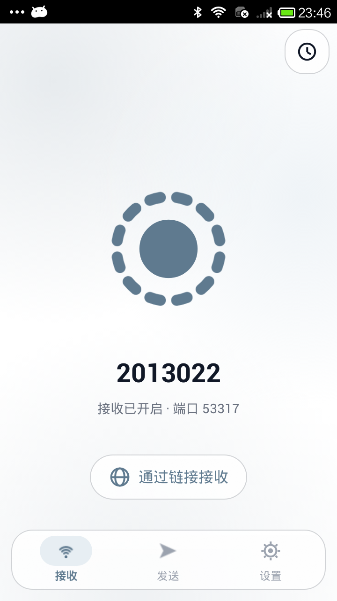
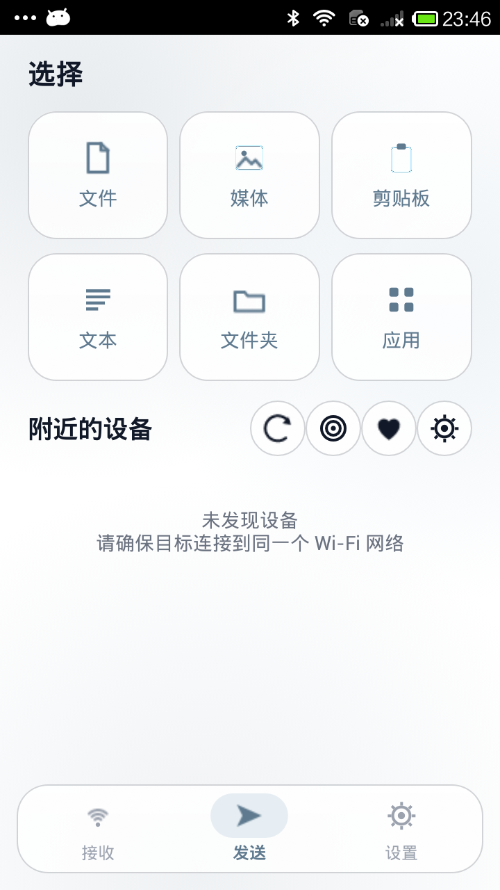
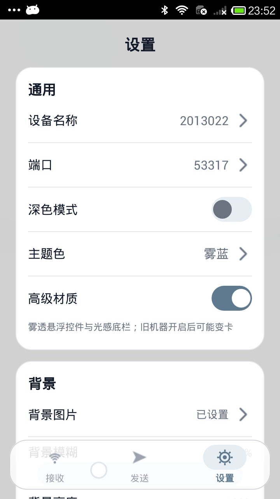
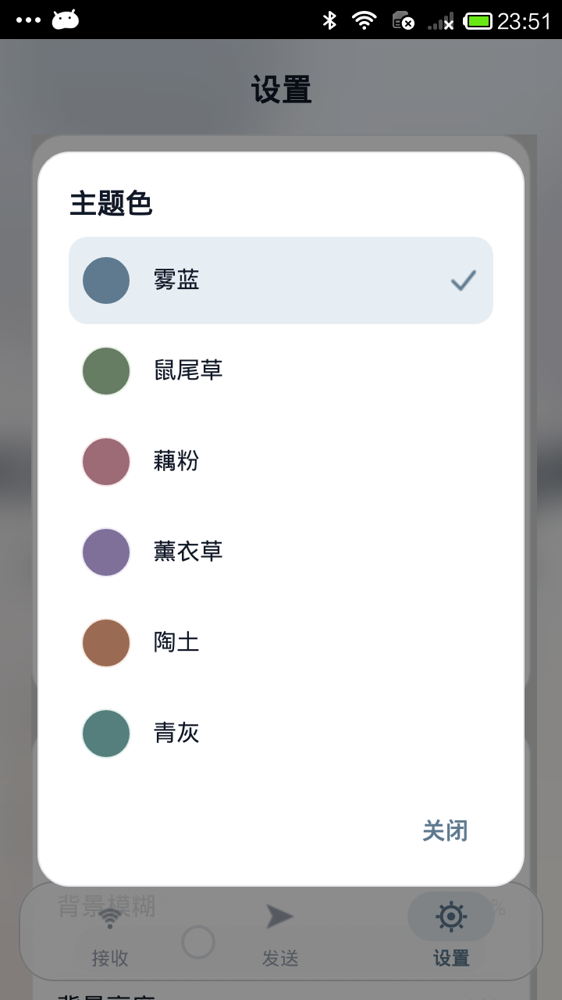
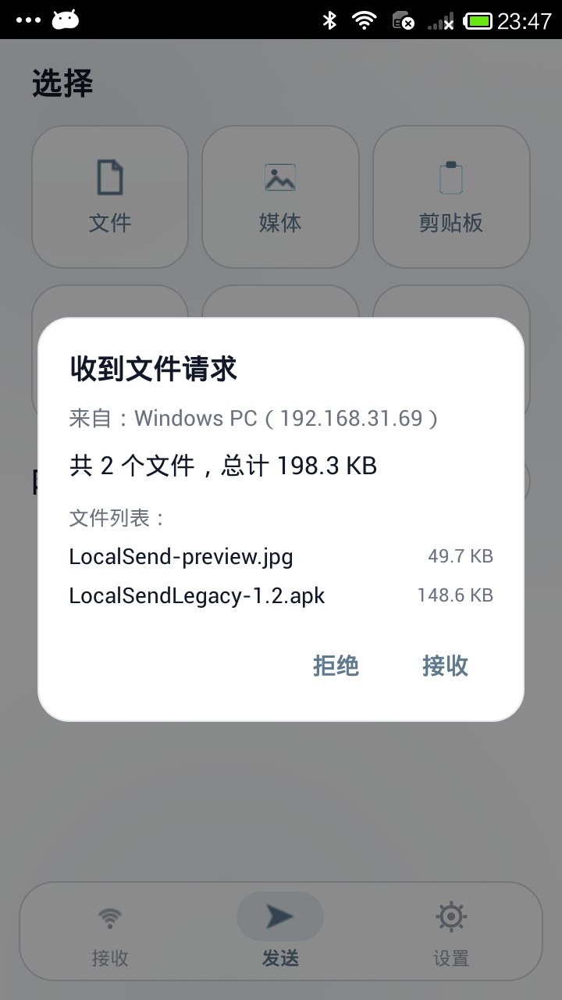
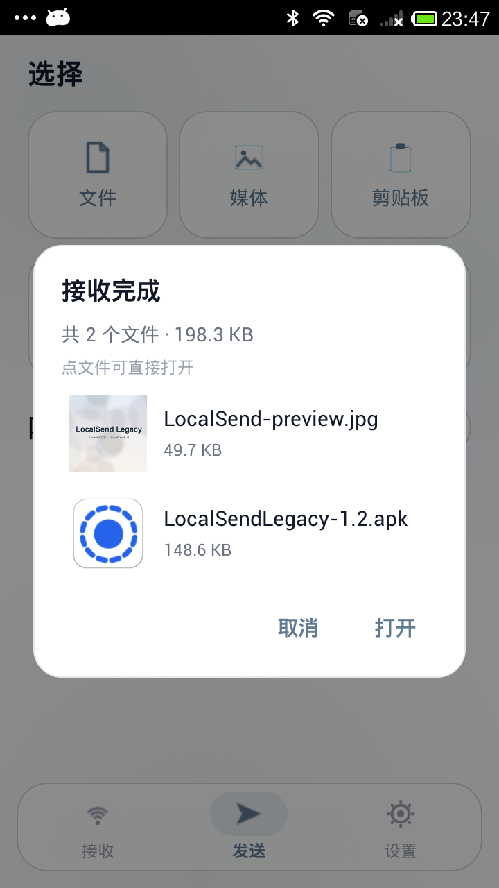
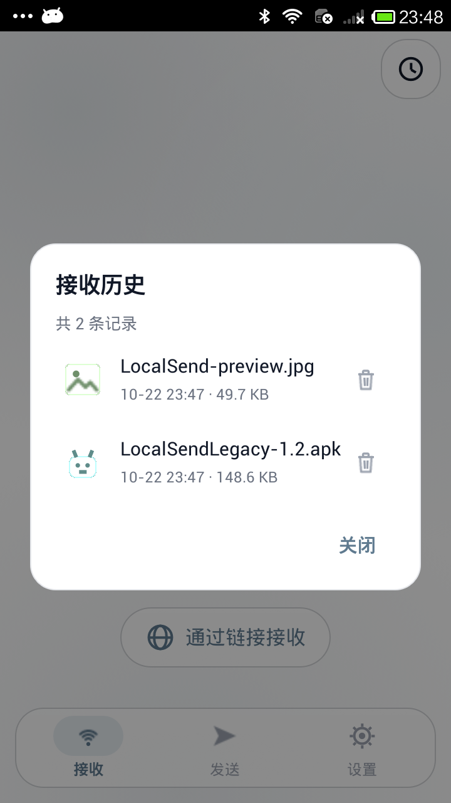
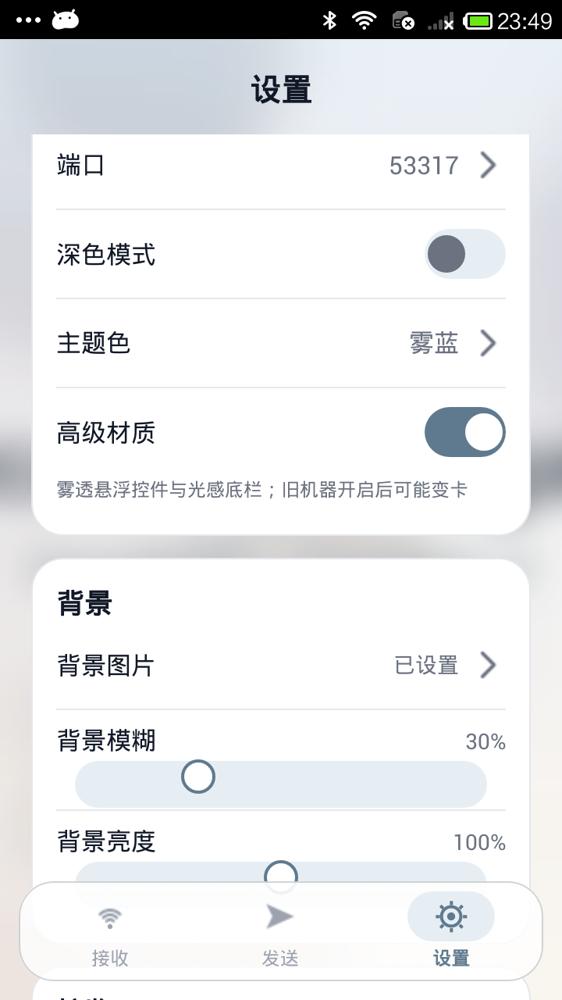
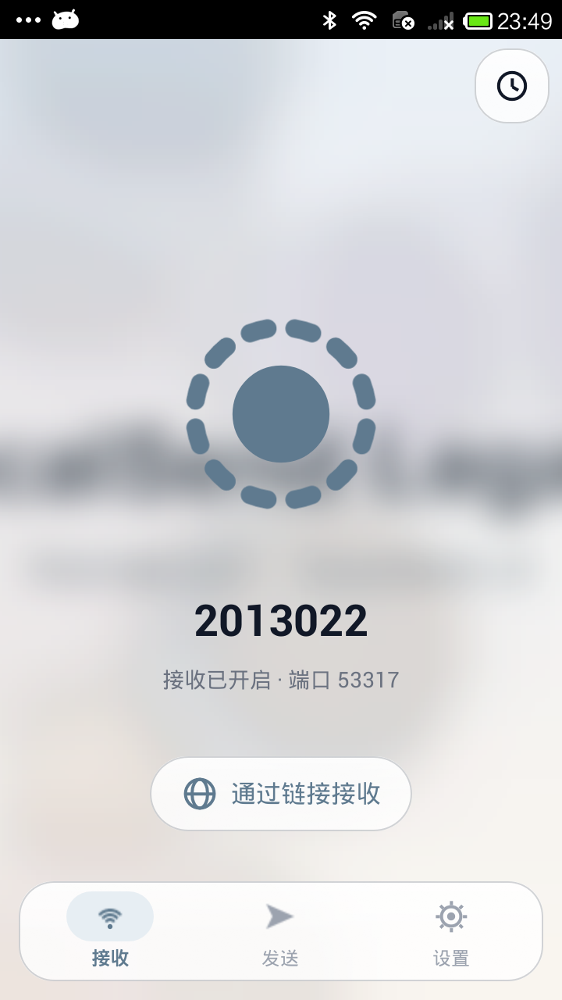

# LocalSend Legacy（老机版）

让 **Android 2.2+ 的老手机** 也能用 [LocalSend](https://localsend.org) 的独立 Android 客户端：同一 Wi-Fi 下收发文件，不需要互联网、不需要账号，与官方 LocalSend v2 的**明文 HTTP** 模式互通。


-blue)


> 纯 Java 6 风格手写实现，无 AndroidX / AppCompat / Kotlin / 原生库；release APK 约 150 KB。  
> 已在真机 **Xiaomi 2013022（红米 1，Android 4.2.1 / API 17）** 上完成收发验证。

## 界面

界面参考官方 LocalSend 的 Material 3 风格重做：底部三 tab、悬浮玻璃导航、圆角卡片/对话框、自绘图标与开关；内置 6 套低饱和莫奈色主题、深色模式、高级材质雾透控件和自定义背景图。

真机截图（Xiaomi 2013022 / Android 4.2.1 / 720×1280）：

| 接收 | 发送 | 设置 |
| --- | --- | --- |
|  |  |  |

| 主题色 | 接收确认 | 接收完成（图片缩略图 / APK 图标） |
| --- | --- | --- |
|  |  |  |

| 接收历史 | 背景与模糊/亮度 | 自定义背景效果 |
| --- | --- | --- |
|  |  |  |


## 特性

- **协议**：LocalSend Protocol v2.2 明文 HTTP 服务器/客户端；另兼容 v1 老协议接收端点
- **兼容**：minSdk 8（Android 2.2），同一 APK 可装到 Android 4.x / 5.x … 14；`targetSdk 30`
- **发现**：UDP 组播 `224.0.0.167:53317` 自动发现 + 手动添加 `IP:端口`
- **接收**：确认弹窗 / 自动接收开关；写入 `Download/LocalSendLegacy`（Android 10+ 走 MediaStore，无需存储权限；无外置存储时回退应用私有目录）
- **接收完成**：弹出带预览的窗口，图片显示缩略图、APK 显示应用图标，可点文件直接打开，或点「打开 / 取消」
- **接收历史**：接收首页右上角时钟入口；按文件类型显示图标（图片/视频/音频/APK/PDF/文档/压缩包），可打开文件、仅删除记录，或连同源文件一起删除
- **发送**：文件、图片、文本、剪贴板、已安装应用（读取应用列表并发送其安装包，可切换是否显示系统应用）；多选文件（API 18+）；进度、取消、完成通知
- **外观**：6 套低饱和莫奈色主题（雾蓝/鼠尾草/藕粉/薰衣草/陶土/青灰）+ 深色模式；高级材质开关会启用悬浮玻璃底栏和雾透玻璃控件
- **背景**：可从相册选择自定义背景图，手动调节模糊（0–100%）和亮度（0–200%），支持更换/清除
- **后台**：前台服务常驻，退出应用后仍可接收（受厂商后台策略影响）

## 外观与增强功能

| 功能 | 入口 | 说明 |
| --- | --- | --- |
| 主题色 | 设置 → 通用 → 主题色 | 6 套低饱和莫奈色，每套都有浅色/深色版本，点选后原地重建界面，不黑闪 |
| 深色模式 | 设置 → 通用 → 深色模式 | 整页背景、卡片、文字、图标、对话框、开关、底部导航同步切换 |
| 高级材质 | 设置 → 通用 → 高级材质 | 底部导航变成悬浮玻璃 bar；历史记录、通过链接接收、发送六宫格、刷新/收藏等可点击控件加半透明雾面与细包边 |
| 背景图片 | 设置 → 背景 → 背景图片 | 相册选图，压缩后保存在应用私有目录；可更换、清除 |
| 背景模糊 | 设置 → 背景 → 背景模糊 | 0–100%，松手后重新生成模糊背景 |
| 背景亮度 | 设置 → 背景 → 背景亮度 | 0–200%，拖动实时预览 |
| 接收完成 | 接收完成后自动弹出 | 图片缩略图 / APK 图标预览；点文件打开，或点「打开 / 取消」 |
| 接收历史 | 接收首页右上角时钟按钮 | 文件类型图标、打开文件、仅删记录 / 删除记录和源文件 |
| 应用发送 | 发送 → 应用 | 自动读取已安装可启动应用，可切换是否显示系统应用，发送其 APK |

## 与官方 LocalSend 的互通

LocalSend v2 协议同时允许 `protocol: "http"` 与 `"https"`，设备在组播里声明自己用哪种。官方客户端从 2.x 起默认 HTTPS，而 Android 2.2–4.3 的系统 TLS 栈只有 TLS 1.0，现代对端普遍拒绝，因此在老系统上无法可靠地使用官方加密模式。本应用选择协议允许的 HTTP 模式：

| 场景 | 是否可用 | 说明 |
| --- | --- | --- |
| 本应用 ↔ 本应用 | ✅ | 完整收发 |
| 官方 LocalSend → 本应用 | ✅ 无需设置 | 对方读取本机声明的 `protocol:"http"`，用明文 HTTP 连过来 |
| 本应用 → 官方 LocalSend（默认加密） | ❌ | Android 2.x 无 TLS 1.2；请在官方端关闭加密 |
| 本应用 → 官方 LocalSend（已关闭加密） | ✅ | 官方端：**设置 → 高级设置 → 网络 → 关闭「加密」** |
| LocalSend 1.x（HTTP 老协议）→ 本应用 | ✅ | 兼容 v1 接收端点 |
| LocalSend 1.x ← 本应用 | ❌ | 发送只实现 v2 |

> 结论：**老手机默认就能接收最新官方 LocalSend 发来的文件**；从老手机发往官方客户端时，只需在官方客户端临时关掉「加密」（传完可再打开）。

## 下载安装

- **GitHub Releases**：[Latest Release](https://github.com/wangyiwei1016-cpu/LocalSend-Legacy/releases/latest)
  - `LocalSendLegacy-release.apk`：正式签名（v1+v2），推荐安装
  - `LocalSendLegacy-debug.apk`：调试版，日志更多
- 仓库内 `dist/` 也保存了构建产物
- `adb install -r LocalSendLegacy-release.apk`，或用文件管理器安装

| 项 | release | debug |
| --- | --- | --- |
| 版本 | 1.2（versionCode 3） | 同左 |
| minSdk / targetSdk | 8 / 30 | 同左 |
| 大小 | 145,221 B | 173,707 B |
| SHA-256 | `2913B80D7D629C8B7561DAADA6D9BE8BB249C8C6911C98B91A58AA05A1AD9C72` | `4BFAED5FBB88B31A48A805A5464A7F1A5F074022BAA74FBF18F9A0E72E725CC6` |
| 签名 | v1=true、v2=true | v1=true、v2=true（debug） |

> 2026-10-23 重新上传了 1.2 安装包（版本号不变），修复三处问题：切换页面后自定义背景消失、设置页「背景模糊 / 背景亮度」滑杆圆点偏移、关闭接收完成 / 发送进度弹窗后背景变成空白；功能与协议没有变化。

## 使用

1. 两台设备连接同一 Wi-Fi / 局域网；
2. 打开应用，「接收」页显示本机名称与端口（默认 `53317`）；
3. 对方设备出现在「发送」页的「附近的设备」里；没出现就点刷新，或用「手动添加」输入 `IP:53317`；
4. 接收：对方发起后本机弹出确认框，点「接收」，文件保存到 `Download/LocalSendLegacy/`；
5. 发送：在「发送」页选择文件/图片/文本/剪贴板/应用（点「应用」后从已安装列表里选一个，发送其 APK），再点目标设备，等待对方确认；
6. 接收完成后会弹预览窗口；点接收页右上角时钟可看历史、打开文件或删除记录；
7. 「设置」页可修改设备名、端口、自动接收，切换主题色/深色模式/高级材质，设置背景图片及其模糊、亮度，查看本机指纹与版本。

## 构建

环境：Windows / macOS / Linux + JDK 17+、Android SDK Platform 34 + Build-Tools 34.0.0、Gradle 8.13（wrapper 已带）。

```bash
./gradlew assembleDebug          # 构建 debug APK
./gradlew testDebugUnitTest      # 48 项协议/工具单元测试
./gradlew assembleRelease        # release（需在仓库根目录配置 keystore.properties）
```

Windows 一键脚本（构建 + aapt2/apksigner 校验 + 复制到 `dist/`）：

```powershell
.\build.ps1            # debug
.\build.ps1 -Release   # release
.\build.ps1 -Install   # 构建并安装到已连接设备
```

### 正式签名

签名密钥 **不会** 提交到仓库。复制 `keystore.properties.example` 为 `keystore.properties` 并填入自己的 keystore：

```properties
storeFile=../localsend-keys/release.keystore
storePassword=你的密码
keyAlias=你的别名
keyPassword=你的密码
```

`keystore.properties`、`*.keystore`、`*.jks`、`local.properties` 均已被 `.gitignore` 忽略。

## 技术实现

- **语言**：Java 6 语法风格（无 lambda / try-with-resources / diamond / String switch），由 D8 反糖到 min-api 8
- **依赖**：仅 Android framework；无 AndroidX（其 minSdk 已 14/21），列表/对话框/通知/样式全部原生实现
- **协议核心**（`app/src/main/java/com/legacy/localsend/core/`，纯 Java、零 `android.*` 依赖，可在桌面 JVM 单元测试）：
  - `LsServer`：`ServerSocket` HTTP 服务器，v2 `info/register/prepare-upload/upload/cancel` + v1 兼容端点
  - `LsClient`：`register` / `prepare-upload` / 流式 `upload` / `cancel`
  - `Discovery`：UDP 组播 announcement + `/register` 回注册
  - 会话令牌、来源 IP 校验、单活动会话、增量 SHA-256、路径穿越清洗、上传按声明大小限流
- **Android 层**：单个 `MainActivity` 三 tab + 前台 `ServerService` + `AndroidStorage`（MediaStore / 公共下载目录 / 私有目录回退）+ `ui/kit` 自绘组件
- **兼容处理**：API>8 调用全部 `Build.VERSION.SDK_INT` 分支 / `@TargetApi` 嵌套类隔离；`core/NetUtil` 的 `NetworkInterface`（API 9）在 API 8 上被 `catch(Throwable)` 安全降级，UI 层用 API 1 的 `WifiManager` 兜底取 IP

### 目录结构

```text
.
├─ app/                       Android 应用模块
│  ├─ src/main/java/com/legacy/localsend/
│  │  ├─ core/                纯 Java 协议核心（HTTP 服务器/客户端/发现/JSON）
│  │  └─ ui/                  界面、服务、存储（含 ui/kit 自绘组件）
│  ├─ src/main/res/           布局、形状 drawable、主题、图标
│  └─ src/test/java/…/core/   JUnit 协议/工具测试（48 项）
├─ docs/                      协议说明、审计与验证报告、截图
├─ dist/                      构建产物（APK）
├─ build.ps1                  Windows 一键构建/校验/安装
├─ gradle/ gradlew gradlew.bat
└─ README.md
```

## 验证

- **单元测试**：48 项全部通过（Json、LsServer v2/v1、上传限流、LsClient 回环、Discovery 报文）
- **Android Lint**：0 Error / 0 NewApi（`core/NetUtil` 的 API 9 枚举为记录在案的设计取舍）
- **DEX**：Dalvik 格式 035，无反汇编出的 Java 7/8 语法与 API>8 框架引用
- **模拟器**：Android 4.0.3（API 15）— PC→App 单/多文件（中文名、长名、0 字节、二进制）SHA-256 一致；拒绝 403；App→PC 发送；设置保存/服务重启
- **真机**：Xiaomi 2013022（Android 4.2.1 / API 17）— 安装运行、发现 Windows/Oppo 设备、PC→手机单/多文件 SHA-256 一致、自动接收、改别名重启、三 tab 界面截图
- 详细报告：[docs/VERIFICATION.md](docs/VERIFICATION.md)、[docs/AUDIT.md](docs/AUDIT.md)

## 已知限制

- **明文传输**：同一 Wi-Fi 下可被嗅探，请仅在可信局域网使用；不支持 HTTPS 对端 / 官方默认加密的客户端
- 未实现浏览器 Web 下载页（announce 中 `download:false`），「通过链接接收」仅给出说明
- 文件夹发送暂不支持；应用仅发送基础 APK（Android 5.0+ 的 split APK 只发 base.apk）；不支持断点续传
- 背景图会压缩成 JPEG（最长边 1600px）保存在应用私有目录；不跟随图片 EXIF 旋转信息，极端情况下横拍照片可能方向不对
- Android 2.0/2.1（API 5–7）未纳入支持范围（最低 2.2）
- 没有 API 8 真机/模拟器镜像，2.2 兼容性通过 Lint + DEX 反汇编 + API 15 Dalvik 交叉验证；建议在真实 2.2/2.3 机器上再验证一次
- 老系统的系统字体会影响部分圆角/字重观感，功能不受影响

## 协议与安全

- 协议实现说明：[docs/PROTOCOL.md](docs/PROTOCOL.md)
- 兼容性/安全审计：[docs/AUDIT.md](docs/AUDIT.md)
- 安全提示：明文模式下 fingerprint 只是随机身份标识，**不是**安全凭据；接收端有确认弹窗、文件名清洗、会话 token 与来源 IP 校验

## License

[MIT](LICENSE)

本项目为 LocalSend 协议的独立兼容实现，与 LocalSend 官方无隶属关系；LocalSend 名称与协议规范版权归其作者所有。详见 [NOTICE.md](NOTICE.md)。

---

## English summary

**LocalSend Legacy** is an independent Android client for the [LocalSend](https://localsend.org) protocol, built to run on **Android 2.2 (API 8) and above** — including very old devices that cannot use modern TLS. It implements the LocalSend v2 plain-HTTP protocol (`protocol:"http"`) plus the legacy v1 receive endpoints, with a hand-drawn Material 3 style UI (six low-saturation Monet palettes, dark mode, optional frosted-glass controls), no AndroidX/Kotlin/native libs, and a ~150 KB APK. Besides files, text and clipboard, it can send the APK of any installed app (with an option to include system apps), shows a preview dialog after receiving, keeps a received-file history with per-type icons, and supports a custom background image with adjustable blur and brightness.

- Receiving from the latest official LocalSend works out of the box (the official sender follows the receiver's advertised `protocol:"http"`).
- Sending to an official LocalSend peer requires disabling **Encryption** on that peer (Settings → Advanced settings → Network), because Android 2.x has no TLS 1.2.
- Verified on Xiaomi 2013022 (Android 4.2.1) and an Android 4.0.3 emulator; 48 unit tests pass.

Build: `./gradlew assembleDebug` or `./build.ps1 -Release` (see [README](README.md) above).

